<div align="center">

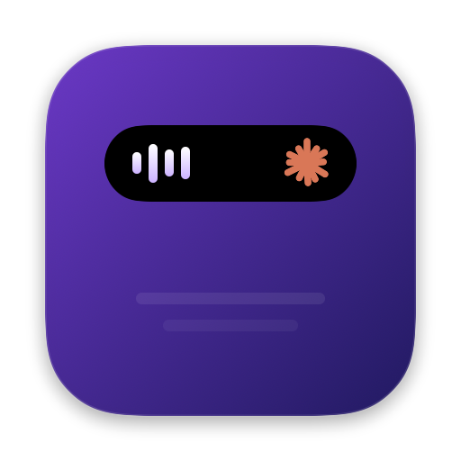

# NotchBar

**Your MacBook notch, as a Dynamic Island.**

Music, meetings, Claude usage, timers, clipboard and headphones, right where your camera is.
Native SwiftUI, no dependencies, and almost no battery.


[](LICENSE)

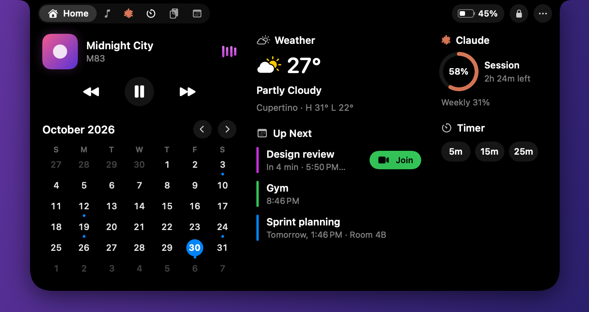

[Features](#features) · [Install](#install) · [Claude Code](#connect-claude-code) · [Performance](#performance) · [How it works](#how-it-works) · [FAQ](#faq) · [Contributing](#contributing)

</div>

---

## Why NotchBar

The notch is dead space on every modern MacBook. NotchBar puts it to work without getting in your way:

- **Glanceable.** The closed notch grows only as far as its content: a few waves when music plays, a Claude logo, a countdown.
- **One click away.** Hover for a small grow and a trackpad haptic. Click to open. Move away and it closes.
- **Native.** Spring animations, SF Symbols, system materials and haptics. No web views, no Electron.
- **Light.** 0.1% CPU at rest and 52 MB of memory, measured on the finished build. See [Performance](#performance).
- **Private.** Nothing leaves your Mac unless you turn on weather. NotchBar never reads passwords or tokens.

## Features

### The closed notch

A status on each side of the camera, and nothing when there's nothing to say.

| | |
|:--|:--|
| 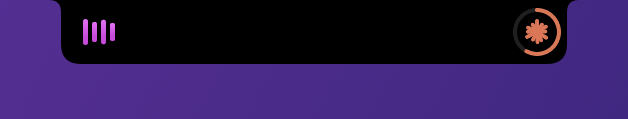 | **Now playing.** Waves tinted with the artwork's color. |
|  | **Claude.** A usage ring. The spark spins while Claude Code works and pulses amber when it needs you. |
| 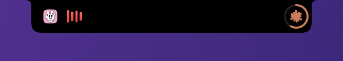 | **Dictation.** Handy, Superwhisper, Wispr Flow, MacWhisper or VoiceInk, while it listens. |
| 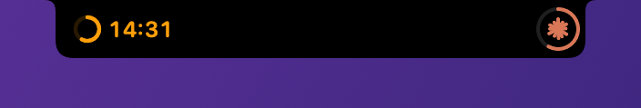 | **Timer.** A live countdown. |

### Banners

Banners drop from the notch for a moment, then tuck back in.

| | |
|:--:|:--:|
| 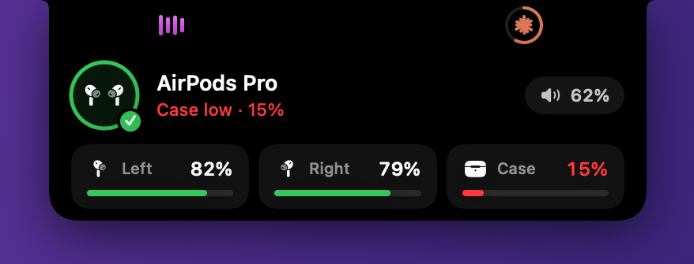<br>**Headphones connect** with battery for each bud and the case. | 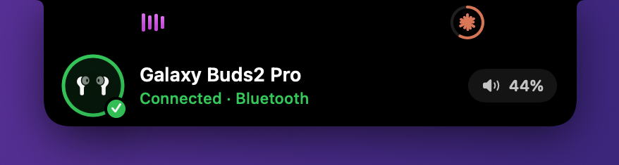<br>**Any earbuds** get the AirPods-style animation. |
| 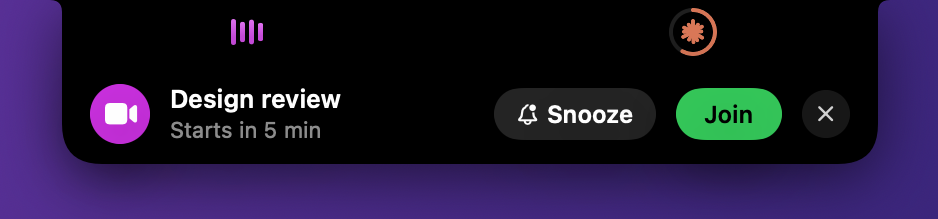<br>**Meetings** 5 minutes ahead, with **Join** and **Snooze**. | 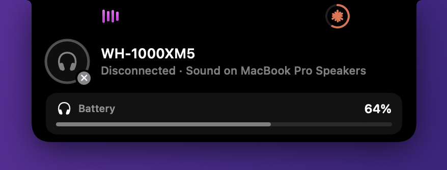<br>**Disconnects** say where your sound went. |
| 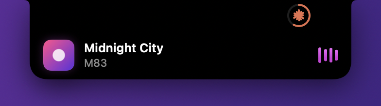<br>**New track** with artwork. | 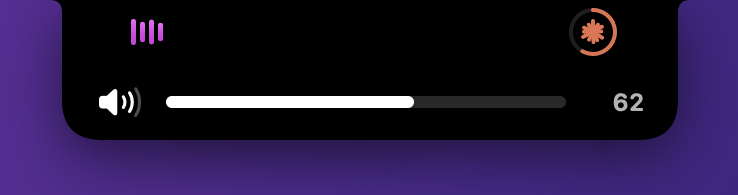<br>**Volume and brightness** you can drag. |

### Tabs

<table>
<tr><td width="50%">

**Media.** Artwork, a scrubber and controls for whatever is playing.

- Music, Spotify and VLC show full track info.
- Chrome, Edge, Brave, Arc and Safari show the playing tab, and YouTube shows its thumbnail.
- Any other app shows its name and icon.
- Paused media stays on screen.

</td><td>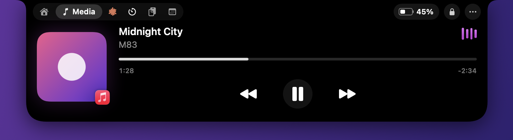</td></tr>
<tr><td>

**Claude.** Your 5-hour session and weekly limits with reset times, an activity chart and a model breakdown. Live numbers come from Claude Code, and NotchBar estimates when they aren't available. See [Connect Claude Code](#connect-claude-code).

</td><td>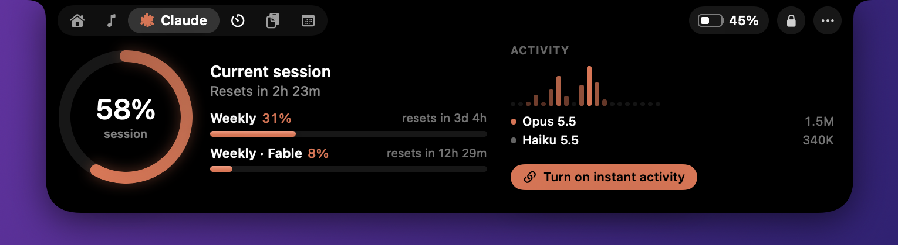</td></tr>
<tr><td>

**Calendar.** The month at a glance and your next events. Teams, Zoom, Meet and Webex links get a **Join** button.

</td><td>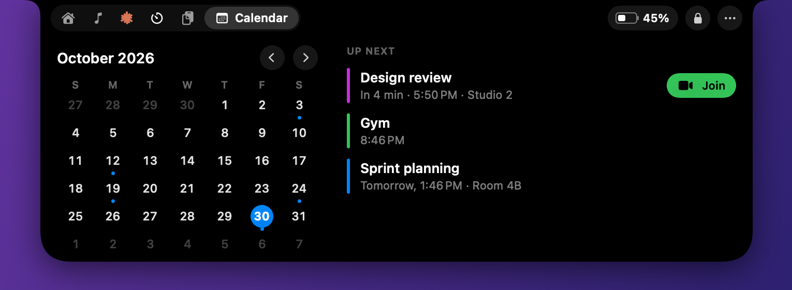</td></tr>
<tr><td>

**Clipboard.** Your last 60 copies: text, links, images and files. Click to copy again, or paste, pin or delete. Press <kbd>⌃</kbd><kbd>⌘</kbd><kbd>V</kbd> anywhere to open it. Password managers and concealed items are skipped.

</td><td>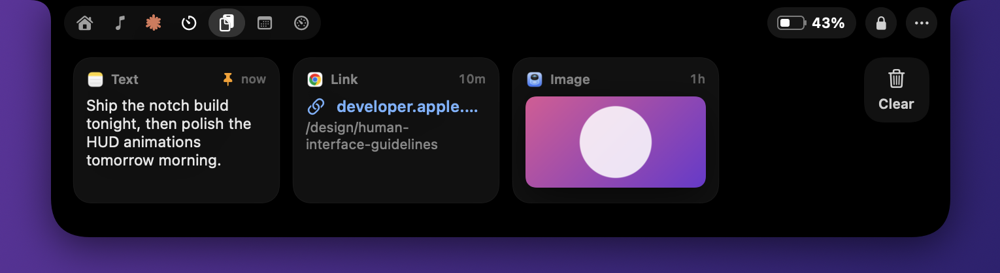</td></tr>
<tr><td>

**Timer.** Presets, pause, +1 minute, a countdown beside the notch, and a chime.

</td><td>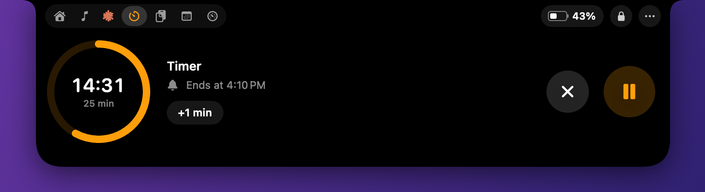</td></tr>
</table>

<details>
<summary><b>And a few more things</b></summary>

- **Home.** Everything above on one page, plus weather. Each widget's title opens its full tab.
- **Weather.** Off until you turn it on. It uses your approximate location and the free Open-Meteo service.
- **Tidy menu bar.** **… > Tidy Menu Bar Icons** tucks icons you rarely use behind a chevron, so the ones you need fit beside the notch. ⌘-drag an icon right of the thin divider to keep it visible.
- **Lock Screen** and battery level in the header.
- **Show only what you use.** Hide any tab from **… > Show Tabs**, and turn off banners you don't want from the same menu.

</details>

## Install

You need macOS 14 or later and the Xcode Command Line Tools. Full Xcode isn't required.

```bash
xcode-select --install
```

```bash
git clone https://github.com/srisanthosh/NotchBar.git && cd NotchBar
```

Run this once. It creates a local signing certificate, so macOS remembers the permissions you grant across rebuilds:

```bash
scripts/setup-signing.sh
```

Then build and launch:

```bash
./build.sh --run
```

The app is built to `build/NotchBar.app`. Copy it to `/Applications` to use **Launch at Login** from the **…** menu.

<details>
<summary><b>Why the signing step?</b></summary>

Without it the app is signed ad hoc, and macOS treats every build as a new app. Accessibility, Automation and Calendar permissions would be forgotten each time you rebuild. The certificate stays in your login keychain and signs only NotchBar. If macOS asks whether `codesign` may use the key, choose **Always Allow**.

</details>

### Permissions, only when you need them

Nothing is asked for at launch. Each permission comes up the first time you use the feature that needs it.

| Feature | Permission | When it's asked |
|---|---|---|
| Track info from Music, Spotify, VLC and browsers | Automation, per app | The first time that app plays |
| Controlling browsers, instant pause detection in Chrome, paste, replacing the system HUD | Accessibility | When you first use one of them |
| Calendar tab and Up Next | Calendars | When you click **Allow** in the tab |
| Weather | Location | When you click **Show Weather** |
| Artist, artwork and progress from Chrome or Safari | **Allow JavaScript from Apple Events**, a browser setting | You turn it on yourself: Chrome's **View > Developer** menu, or Safari's **Develop** menu |

Detecting which app is playing, dictation and headphones need no permission at all.

## Connect Claude Code

NotchBar works with Claude Code out of the box. It estimates your usage from the transcripts Claude Code keeps in `~/.claude/projects`.

**For live limits and instant activity, connect it once:**

1. Open the notch and go to the **Claude** tab.
2. Click **Connect Claude Code**.
3. Use `claude` in Terminal once. Your real limits appear within seconds.

Connecting adds two small scripts to `~/.claude/settings.json`, and saves a backup of the file first. **… > Disconnect Claude Code** removes everything it added.

| What you get | Terminal `claude` | Desktop app and VS Code |
|---|:--:|:--:|
| Spinner starts and stops the moment Claude does | ✅ | ✅ |
| Amber pulse when Claude needs your approval | ✅ | ✅ |
| Real 5-hour and weekly limit percentages | ✅ | Last reading from Terminal |
| Estimated session usage, calibrated to your plan | ✅ | ✅ with **Match Claude** |

Why the difference? Claude Code reports plan limits only to its status line, and only the terminal version runs a status line. The Claude apps read your limits from Anthropic with your sign-in, which NotchBar never touches. The activity hooks run everywhere.

**How the estimate works.** When there's no current reading, NotchBar adds up what each reply cost from the transcripts, weighing tokens the way the API prices them (output 5×, cache writes 1.25×, cache reads 0.1×, smaller models less). Each real reading teaches it what one percent of your plan costs, and when your window started. The ring then says **est. session**, and the footer says where the scale came from.

**Only use the desktop app or VS Code?** Click **Match Claude** in the Claude tab footer (or **… > Match Claude's Usage…**) and type in the two numbers from Claude's **Account & Usage** window: the Session (5hr) percentage and its reset time. That's all the estimate needs.

Estimates drift when you also use Claude elsewhere, such as claude.ai or another Mac, because NotchBar only sees this Mac's Claude Code. That use counts toward the same limit and can start a window earlier. Match again, or use `claude` in Terminal, to line it back up.

<details>
<summary><b>I already have my own status line</b></summary>

NotchBar leaves an existing status line alone. To feed it from your script, add this line where your script has read its input into `$input`:

```bash
printf '%s' "$input" | jq -c '{rate_limits: .rate_limits, updated_at: now}' > ~/.claude/notchbar/limits.json
```

</details>

<details>
<summary><b>What exactly gets installed?</b></summary>

- `~/.claude/notchbar/activity.sh` runs on the `UserPromptSubmit`, `Stop`, `SessionEnd` and `Notification` hooks. It writes one tiny marker file per busy session and prints nothing, so it never adds to Claude's context.
- `~/.claude/notchbar/statusline.sh` is the status line. It saves the `rate_limits` Claude Code sends to `limits.json`, and draws a compact status line with your model and limits.

Some plans report only the 5-hour window. Then the weekly area shows this week's token count.

</details>

## Performance

NotchBar is built to run all day on battery. These numbers are from the finished build on an M-series MacBook Pro, measured with `top` while Claude Code was working and its spinner animating:

| Measure | Result |
|---|---|
| CPU at rest, over 60 seconds | **0.1%** |
| CPU with the notch open on Home | **0.0%** |
| Wakeups at rest | **10 per minute** |
| Memory footprint | **52 MB** |
| Launch | **0.15 s** |
| App size | **4.5 MB** |

Measure it yourself:

```bash
top -l 2 -s 60 -pid $(pgrep -x NotchBar) -stats pid,cpu,idlew,power,mem | tail -1
```

<details>
<summary><b>What made the biggest difference</b></summary>

| Change | Before | After |
|---|---|---|
| A sensor window over the notch instead of watching every mouse move | 50 wakeups a second while you use the mouse | none |
| Microphone checks triggered by events instead of a timer during calls | 1.5% CPU | 0% |
| The Claude spinner as a Core Animation layer instead of a SwiftUI rotation | 8% CPU | 0% |

</details>

## How it works

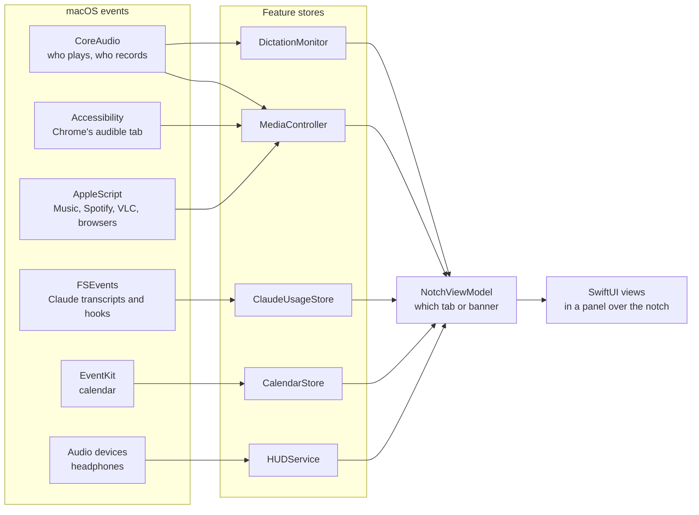

- **Events instead of polling.** CoreAudio reports when any app's audio starts or stops. Music and Spotify post change notifications. FSEvents reports transcript and hook changes. DisplayServices reports brightness, and IOKit reports battery.
- **Polling only where macOS offers nothing else, and only while needed.** Browser tabs and VLC are checked while they play. The clipboard change counter is one cheap call every half second.
- **The pointer costs nothing until it reaches the notch.** A nearly invisible sensor window over the notch gets one event when the pointer arrives. NotchBar follows the pointer only while it's on the notch or the notch is open.
- **Animations run in the compositor.** The window server animates the waves and the Claude spinner with no CPU from NotchBar.
- **Everything pauses** while the displays sleep or the Mac is locked.
- **Incremental reads.** Transcripts are append-only, so only new lines are read.

<details>
<summary><b>Notes on macOS quirks, for contributors</b></summary>

- On current macOS, CoreAudio never sends change notifications for a process's "running output" and "running input" flags, though the values change. It does notify for the general "running" flag and for devices, so NotchBar listens to those and then reads the flags.
- Chrome names each tab in its tab strip "Title" followed by status notes in any order, such as "– Audio playing" and "- Memory usage - 462 MB". The audible marker isn't always last.
- Chrome holds its audio stream open about 15 seconds after a pause, so pause detection reads the tab strip instead.
- Connecting headphones restores their saved volume, which reports a volume change. Device banners outrank the volume HUD so they aren't replaced.
- TCC permissions belong to the responsible process. Launch NotchBar with `open`, not from a terminal, when testing permissions.

</details>

## Privacy

- **Stays on your Mac.** Everything NotchBar reads stays on your Mac. The only network request is weather, once you turn it on, and the location it sends is rounded to about a kilometre.
- **No content.** NotchBar sees that an app uses the microphone, never what it hears.
- **No secrets.** NotchBar never reads passwords, tokens or keychain items.
- **Clipboard.** Concealed items and password managers are skipped.

## FAQ

<details>
<summary><b>The Claude ring shows "est. session". Is it connected?</b></summary>

Yes, if the footer doesn't offer **Connect Claude Code**. "est." means the number is NotchBar's estimate, because there's no current real reading. Use `claude` in Terminal once, or click **Match Claude** and type in what Claude's Account & Usage window shows.

</details>

<details>
<summary><b>NotchBar's percentage differs from the Claude app's.</b></summary>

The Claude app shows your exact usage across everything: Claude Code, claude.ai and other devices. NotchBar estimates from this Mac's Claude Code transcripts. Click **Match Claude** to line the two up. A terminal `claude` reading does the same on its own.

</details>

<details>
<summary><b>Chrome shows the tab title but no artist or progress.</b></summary>

Turn on **View > Developer > Allow JavaScript from Apple Events** in Chrome. In Safari, the same setting is in the **Develop** menu. NotchBar then reads the page's media session.

</details>

<details>
<summary><b>My headphones show no battery.</b></summary>

AirPods and Beats report each bud and the case to macOS. Many other headphones report battery only to Control Center's Bluetooth menu, which other apps can't read. Their banner still shows the connection and volume.

</details>

<details>
<summary><b>The status line doesn't update on macOS 14.</b></summary>

The status line script uses `jq`, which ships with macOS 15 and later. On macOS 14, install it with `brew install jq` and edit the path in `~/.claude/notchbar/statusline.sh`.

</details>

<details>
<summary><b>Does it work without a notch?</b></summary>

Yes. On a Mac without a notch, NotchBar draws a small pill under the menu bar.

</details>

## Development

<details open>
<summary><b>Useful commands</b></summary>

Render every state to PNG with sample data, for reviewing design changes:

```bash
swift build -c release && .build/release/NotchBar --snapshot ./snapshots
```

Regenerate the README screenshots from those snapshots:

```bash
swift scripts/crop-screenshots.swift ./snapshots docs/screenshots 00-home 09-media 13-claude-live
```

Print the usage NotchBar reads from your transcripts:

```bash
.build/release/NotchBar --usage
```

Drive a running copy from the command line. Start it with `open --env NOTCHBAR_DEBUG=1 build/NotchBar.app`, then:

```bash
scripts/debug.sh open:claude
```

Other commands include `airpods`, `buds`, `meeting`, `volume`, `shot:/tmp/notch.png` and `state:/tmp/state.json`. See `App/DebugCommands.swift` for all of them.

Regenerate the app icon after changing `App/AppIcon.swift`:

```bash
.build/release/NotchBar --make-icon Resources/AppIcon.iconset && iconutil -c icns Resources/AppIcon.iconset
```

</details>

### Project layout

```
Sources/NotchBar/
  App/        Entry point, wiring, and developer tools
  Notch/      The window, the pointer sensor, the shape, and the open and closed layouts
  Features/   One folder per feature, each with a store or controller and its views
    Media/      What's playing: CoreAudio activity, player scripts, browser tabs
    Claude/     Transcript scanner, Claude Code integration, usage panel
    Home/       The master page and its compact widgets
    Calendar/   EventKit store, calendar panel, meeting reminders and snooze
    Weather/    Opt-in weather from Open-Meteo
    MenuBar/    The menu bar organizer
    Dictation/  Shows dictation apps like Handy while they listen
    Clipboard/  Clipboard history
    Timer/      Countdown timer
    HUD/        Volume, brightness, headphones, and the optional key takeover
  Shared/     Small helpers: sleep-aware timer, file watcher, controls, formatting
```

Each feature has the same shape. A `@MainActor` `ObservableObject` owns the state and does the work, and SwiftUI views observe it. `NotchViewModel` decides which tab or banner shows. `NotchController` keeps the window over the notch and handles the pointer.

## Roadmap

- [x] Now playing from any app, with browser tabs
- [x] Claude usage with live limits and instant activity
- [x] Calendar with Join and Snooze
- [x] Clipboard history
- [x] Headphones, dictation, volume and brightness banners
- [ ] Notifications in the notch
- [ ] More Live Activities
- [ ] A <kbd>⌘</kbd><kbd>K</kbd> command palette

## Contributing

Issues and pull requests are welcome, including your first ever open source contribution. The [contributing guide](CONTRIBUTING.md) walks you through setting up your Mac, making a change and opening a pull request.

- 🐛 [Report a bug](https://github.com/srisanthosh/NotchBar/issues/new?template=bug_report.yml)
- 💡 [Suggest a feature](https://github.com/srisanthosh/NotchBar/issues/new?template=feature_request.yml)
- 🔒 [Report a security problem privately](SECURITY.md)

The short version: keep it native and dependency-free, use system events rather than timers, check your change with `--snapshot`, and measure anything that runs in the background. Everyone taking part follows the [Code of Conduct](CODE_OF_CONDUCT.md).

## License

Copyright © 2026 Sri Santhosh N.

NotchBar is free software under the [GNU General Public License v3.0](LICENSE). You can use, study, change and share it. If you share a changed version, or an app built from this code, you must release its source code under the same license.

**Name and icon.** The license covers the code, not the NotchBar name or its icon. If you publish a fork, give it its own name and icon, so nobody mistakes it for NotchBar.
